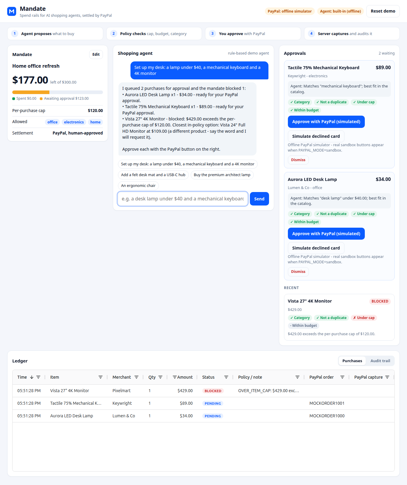
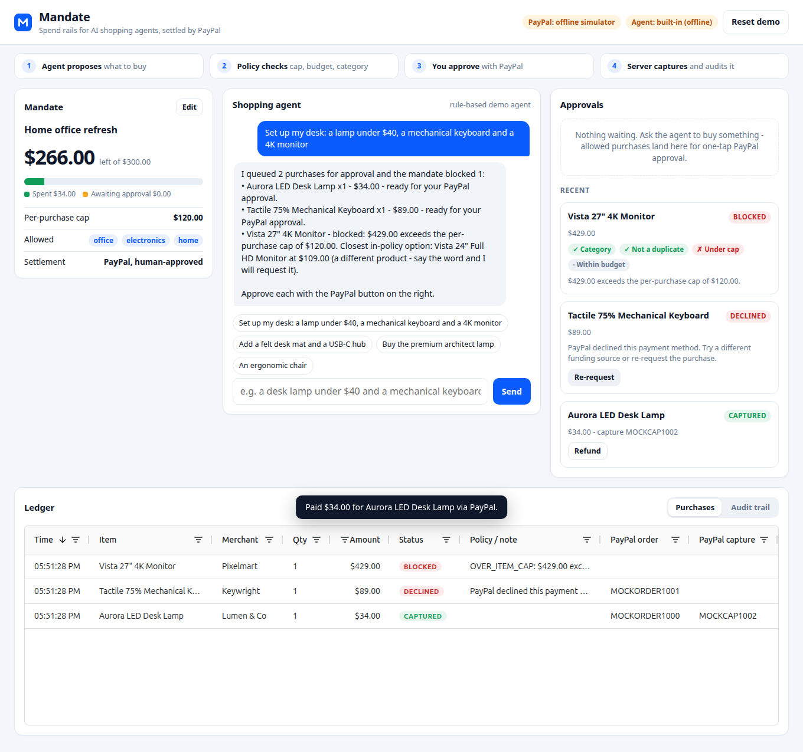
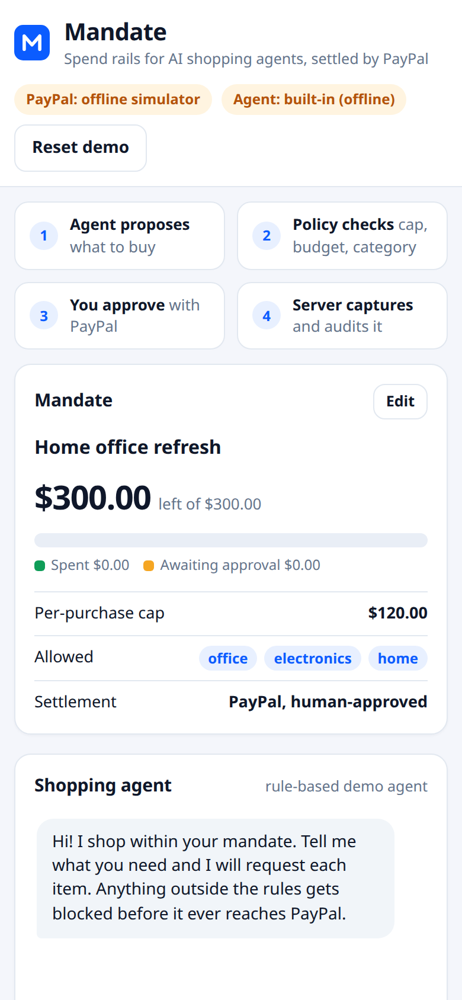

# Mandate - spend rails for AI shopping agents, settled by PayPal

Give an AI agent a **spending mandate** (budget, per-purchase cap, allowed categories). It shops for you; a policy engine approves or blocks every request *before PayPal is called*; allowed purchases become real **PayPal sandbox orders** that you approve with one tap; every decision lands in a live **AG Grid** ledger. Built for the PayPal AI Hackathon.



## How PayPal is used (it is the trust layer, not a checkout button)
| Step | PayPal API | Where |
|---|---|---|
| Agent's approved request becomes an order, **server-side**, amount from the DB (never the client/LLM), `PayPal-Request-Id` idempotency + unique `invoice_id` | `POST /v2/checkout/orders` | [src/paypal.js](src/paypal.js) |
| Human approves the order in the PayPal popup | PayPal JS SDK Buttons (`createOrder` returns our server-created order id) | [public/app.js](public/app.js) |
| Server captures, then verifies amount/currency; duplicate captures are confirmed via `GET` | `POST /v2/checkout/orders/{id}/capture`, `GET /v2/checkout/orders/{id}` | [src/purchases.js](src/purchases.js) |
| Declined / cancelled / expired / not-approved / already-captured / transient failures handled | 422 issue codes | [src/purchases.js](src/purchases.js) |
| Undo a purchase | `POST /v2/payments/captures/{id}/refund` | [src/purchases.js](src/purchases.js) |
| Async truth: signed events, idempotent on event id | `POST /v1/notifications/verify-webhook-signature`; `PAYMENT.CAPTURE.COMPLETED / DENIED / REFUNDED` | [src/server.js](src/server.js) |

Sandbox only: the config refuses to run against anything but the sandbox host.

## How the AI is used
A real language model reads what you type and decides *what* to buy by calling tools (`search_products`, `propose_purchase`, `get_mandate`): **Google Gemini** (default when `GEMINI_API_KEY` is set; preferred model first, automatic fallback to other Gemini models on overload/quota) or **Anthropic Claude** (`ANTHROPIC_API_KEY`). The model cannot move money or override rules: `propose_purchase` goes through [src/policy.js](src/policy.js) (expiry, category, duplicate, per-purchase cap, remaining budget including pending reservations, pace). The header badge shows which model is answering. If no AI key is configured, or the model is down, the app says so plainly and buys nothing: there is no scripted stand-in shopper.

### Live web shopping (no catalog)
There is no product catalog. `search_products` works in two stages:
1. **Find.** A search provider returns candidate product pages. Providers are tried in order until one yields a verified offer: **Tavily** (free tier), **Serper** (free signup credits), **Gemini + Google Search grounding** (needs a billing-enabled Google key). Providers without a key are skipped; set `SEARCH_PROVIDERS` to change the order.
2. **Verify.** The **server opens every candidate page itself** and reads the price the retailer publishes (schema.org JSON-LD, falling back to `product:price` meta tags), plus the product's title and category. The server, not the model, assigns the mandate category (keyword heuristic over the page's own title/category; unknown -> `other`).

Only verified results become *offers*. `propose_purchase` takes an `offer_id`, so a model cannot invent or alter a price or a category, and offers older than 6 h are refused as stale. Each offer also carries `fits_mandate` (+ `mandate_issue`): the same policy engine, run up front, so Gemini can pick in-policy options and explain the rest. The real gate still runs at purchase time. Pages whose price cannot be read (listicles, bot-blocking retailers, non-USD, out of stock) are skipped; set `ALLOW_UNVERIFIED_PRICES=1` to accept a provider's quoted price instead (flagged "price unverified"). Page fetches are SSRF-hardened (https only, no private/loopback/metadata addresses, DNS checked at connect time, redirects re-validated, size/time caps). Payments are still PayPal **sandbox**: nothing real is charged or shipped.

**Search yourself.** The UI also has a "Search the web yourself" panel (`POST /api/search`, `POST /api/offers/:id/request`): the human searches, sees each offer's `fits mandate` flag and price-verified tag, and requests a purchase. It uses the same offers, policy gate and PayPal approval, so the app stays usable when the AI model is rate-limited. Identical searches are cached for 30 minutes and real provider searches are capped per day (`WEB_SEARCHES_PER_DAY`), which protects the free-tier search quotas; several searches in one model turn run concurrently.

### Bring your own agent (MCP)
Mandate is also an **MCP server** (Streamable HTTP at `/mcp`). Click **Connect an agent**, generate a token, and any MCP client can use the same rails:
```bash
claude mcp add --transport http mandate https://<your-host>/mcp --header "Authorization: Bearer mnd_..."
```
Tools: `search_products`, `propose_purchase`, `get_mandate`. The external agent can only *request* purchases; the policy engine decides, and you approve each one with PayPal in the web UI. The token is stored hashed and can be revoked. The endpoint is tested with the official MCP SDK client (`test/mcp.test.js`).

### The mandate
Budget, per-purchase cap, allowed categories, **pace limit** (max purchase requests per hour) and optional **expiry**. Checks run in this order: active -> category -> duplicate -> cap -> budget -> pace.

## Quick start

Requirements: Node 22.13+ (tested on Node 24).

```bash
git clone https://github.com/wakkaduu/Mandate.git && cd Mandate
npm install
cp .env.example .env        # then fill in values (see below)
npm start                   # http://localhost:3000
```

`npm start` loads `.env` automatically (via `node --env-file-if-exists`); you can also just export the variables in your shell.

### Option A - offline development and tests only (simulator)
```bash
PAYPAL_MODE=mock npm start
```
Uses an in-process PayPal **simulator** and, without an AI key, no shopping at all (there is no scripted agent). This exists for development and the automated test suite; it is refused when `NODE_ENV=production`. The real demo (Option B) uses the real PayPal sandbox and a real language model. The "Approve with PayPal (simulated)" and "Simulate declined card" buttons stand in for the PayPal popup.

### Option B - real PayPal sandbox (what the demo video uses)
1. Go to <https://developer.paypal.com/dashboard/applications/sandbox> (free account), **Create App** (Merchant type), and copy the **Client ID** and **Secret**.
2. Under **Testing tools -> Sandbox accounts**, use the default **Personal** (buyer) account. Its email/password are shown there ("View/edit account"); you log in with those in the PayPal popup. Do not use a real PayPal account.
3. Set in `.env`:
   ```
   PAYPAL_MODE=sandbox
   PAYPAL_CLIENT_ID=...
   PAYPAL_CLIENT_SECRET=...
   ```
4. (Optional) Webhooks: in the app's settings add a webhook pointing at `https://<public-host>/api/paypal/webhook` for `PAYMENT.CAPTURE.COMPLETED`, `PAYMENT.CAPTURE.DENIED`, `PAYMENT.CAPTURE.REFUNDED`, then set `PAYPAL_WEBHOOK_ID`. Locally you need a tunnel (e.g. ngrok); on Render use the service URL. Without it, the app still works: the capture response is the source of truth.
5. AI: set `GEMINI_API_KEY` (get one at <https://aistudio.google.com/apikey>), or `ANTHROPIC_API_KEY`. Free Gemini keys have small **daily per-model quotas**: for a public demo, enable billing on the Google project (usage for this app is a couple of requests per chat).

### Environment variables
| Variable | Required | Purpose |
|---|---|---|
| `PAYPAL_MODE` | yes | `sandbox` (default) or `mock`. Live is unsupported by design. |
| `PAYPAL_CLIENT_ID` / `PAYPAL_CLIENT_SECRET` | sandbox mode | Sandbox REST app credentials |
| `PAYPAL_WEBHOOK_ID` | no | Enables the verified webhook endpoint |
| `TAVILY_API_KEY` / `SERPER_API_KEY` | one of these (or Gemini) | Live product search providers (free tiers); the server verifies every price itself |
| `SEARCH_PROVIDERS` | no | Order providers are tried in (default `tavily,serper,gemini`) |
| `WEB_SEARCHES_PER_DAY` / `WEB_SEARCH_CACHE_MINUTES` | no | Daily cap on real provider searches (default 150) / cache lifetime (default 30) |
| `ALLOW_UNVERIFIED_PRICES` | no | `1` = accept a provider's quoted price when the page price cannot be read |
| `GEMINI_API_KEY` | recommended | Enables the Gemini shopping agent (and Google Search grounding as a last-resort search provider) |
| `GEMINI_MODEL` | no | Comma-separated preferred model + fallbacks (default `gemini-3.1-flash-lite,gemini-3.5-flash,gemini-flash-latest,gemini-3.8-flash`) |
| `ANTHROPIC_API_KEY` / `ANTHROPIC_MODEL` | no | Alternative: Claude (default `claude-opus-5-5`) |
| `AI_PROVIDER` | no | `auto` (default), `gemini`, `claude` or `offline` |
| `TURSO_DATABASE_URL` / `TURSO_AUTH_TOKEN` | Vercel | Remote libSQL database (required on serverless hosts; optional elsewhere) |
| `NODE_ENV` | hosted | `production` on hosted deployments (also blocks the PayPal simulator) |
| `PORT`, `DATABASE_PATH`, `PUBLIC_URL` | no | Server settings |

### Try this demo script
1. Click the first suggestion chip: *"Set up my desk: a lamp under $40, a mechanical keyboard and a 4K monitor"*.
2. See the lamp and keyboard queued under **Approvals** and the 4K monitor **blocked** (over the $120 cap) with a reason and an alternative.
3. Approve the lamp with the PayPal button (sandbox buyer login). Watch the budget bar and the ledger update.
4. Click **Edit** on the mandate, raise the cap, then ask for the monitor again. Dismiss or decline another order to see the budget release; **Refund** a captured purchase to get funds back.
5. Open the **Audit trail** tab to see every policy decision and PayPal event.

## Tests
```bash
npm test
```
Tests: policy unit tests (incl. expiry and pace); the live-web pipeline against stub retailers (price read from the page, not the model; unverifiable results dropped; SSRF guard); end-to-end flow tests (agent -> policy -> order -> approve -> capture, decline, cancel, refund, duplicate capture, budget reservations, session isolation, input validation, CSRF hardening, webhook signature/idempotency/amount-mismatch) against the in-process PayPal simulator; the Claude tool loop against a local stub of the Messages API; and the MCP server driven by the official MCP SDK client.

> Honest status: order creation, order lookup, the not-approved error and the PayPal JS SDK buttons are verified against the real PayPal sandbox; the buyer approval -> capture -> refund -> webhook path is verified against the simulator only. See [DECISIONS.md](DECISIONS.md) and run Option B end to end once before recording.

## Deploy
Both hosts run the same code. Set `NODE_ENV=production`, the PayPal sandbox credentials and an AI key on whichever you use.

### Render (free tier; recommended, also eligible for the Render sponsor prize)
1. The repo is public (the MIT [LICENSE](LICENSE) shows in About).
2. Render -> **New -> Blueprint** -> select the repo ([render.yaml](render.yaml)).
3. Set `PAYPAL_CLIENT_ID`, `PAYPAL_CLIENT_SECRET`, `GEMINI_API_KEY`, `TAVILY_API_KEY`, `SERPER_API_KEY` (and optionally `PAYPAL_WEBHOOK_ID`) in the dashboard. Optional: Turso variables for state that survives restarts.
4. Add the webhook in the PayPal dashboard pointing at `https://<service>.onrender.com/api/paypal/webhook`.
5. Open the URL (the free instance sleeps when idle; the first load can take ~30s).
6. Verify: `npm run smoke -- https://<service>.onrender.com` (health, AI agent, a real sandbox order that it then cancels, webhook and MCP hardening).
7. Optional: point a free uptime monitor at `/healthz` every 5 minutes so the free instance stays awake for judges.

### Vercel
Vercel functions have an ephemeral, per-instance filesystem, so a **remote database is required**.
1. Create a free Turso database: `turso db create mandate`, then `turso db show mandate --url` and `turso db tokens create mandate`.
2. Import the repo in Vercel (framework preset: *Other*). [vercel.json](vercel.json) builds the static assets (`npm run build`), serves `public/` from the CDN and routes `/api/*`, `/mcp` and `/healthz` to the Express app in [api/index.js](api/index.js) (60 s function limit for the AI tool loop).
3. Environment variables: `NODE_ENV=production`, `PAYPAL_CLIENT_ID`, `PAYPAL_CLIENT_SECRET`, `GEMINI_API_KEY`, `TAVILY_API_KEY`, `SERPER_API_KEY`, `TURSO_DATABASE_URL`, `TURSO_AUTH_TOKEN` (+ optional `PAYPAL_WEBHOOK_ID`).
4. Webhook URL: `https://<project>.vercel.app/api/paypal/webhook`. Verify with `npm run smoke -- https://<project>.vercel.app`.
Without Turso the app starts but shows a banner that state is not persistent. Per-instance in-memory pieces (rate limiters, model cooldowns) are best-effort on serverless.

## API
See [docs/API.md](docs/API.md) for the endpoint contract and the single error envelope.

## Project layout
```
src/server.js      Express app, routes, sessions, webhook endpoint
src/purchases.js   Purchase state machine, audit log, PayPal reconciliation
src/policy.js      Mandate policy engine (pure functions)
src/paypal.js      PayPal REST client (orders, capture, refund, webhook verify)
src/agent.js       Provider selection, system prompt, Claude loop, honest no-AI reply
src/llm/gemini.js  Gemini tool loop (REST)
src/llm/gemini-core.js  Gemini transport: model fallback + quota cooldowns
src/web/search.js  Provider fallback + server-side price/category verification
src/web/providers.js  Tavily / Serper / Gemini-grounding candidate finders
src/web/safe-fetch.js  SSRF-hardened page fetcher
src/web/extract.js  Reads price from JSON-LD / product meta tags
src/offers.js      Server-verified offers: the only things an agent can buy
src/tools.js       Tool surface shared by Gemini, Claude and MCP
api/index.js       Vercel serverless entry (the Express app)
src/mcp.js         MCP server (Streamable HTTP, bearer-token auth)
src/mock-paypal.js In-process PayPal simulator (mock mode / tests only)
src/db.js          libSQL (SQLite file or Turso) schema + migrations
src/categories.js  Mandate categories + default mandate
public/            Vanilla JS UI + AG Grid ledger
test/              node:test suites
```

## Screenshots
| | |
|---|---|
|  |  |

## Official Rules
Compliance checklist: [docs/RULES_CHECKLIST.md](docs/RULES_CHECKLIST.md).

## License
MIT - see [LICENSE](LICENSE).
